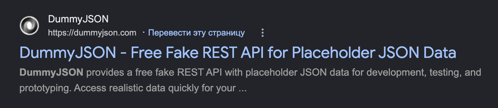
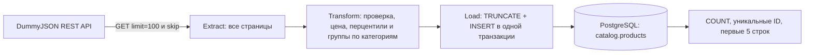

# Дз-1 по DE



*DummyJSON is all I need*

Выполнено Алгазиновым Александром

## Источник и задача

Я собираю ETL-пайплайн: весь каталог товаров из REST API DummyJSON -> преобразования в jupyter -> PostgreSQL в Docker

Источник: https://dummyjson.com/products, документация: https://dummyjson.com/docs/products

Выбрал DummyJSON, потому что API доступен без ключа и поддерживает пагинацию (какое страшное слово я знаю омагад). В данных есть вложенные размеры, необязательный бренд, цены, скидки и рейтинги: можно показать осмысленный Transform, а не просто переложить JSON в БД (хотя перекладывание джейсонов это лютая база)

Это учебные данные каталога, а не реальные продажи. Валюта цены и единицы размеров в используемых полях явно не указаны, поэтому в схеме я их не приписываю

## Схема источника

Ответ GET /products?limit=100&skip=0 содержит products (массив товаров), total (целое число товаров), skip (целое смещение) и limit (целый размер страницы)

Использую следующие поля товара:

+ id: integer, уникальный положительный идентификатор

+ title: string, название товара

+ category: string, код категории

+ brand: string, необязательный бренд; может отсутствовать

+ price: number, исходная цена

+ discountPercentage: number, скидка от 0 до 100

+ rating: number, рейтинг от 0 до 5

+ stock: integer, неотрицательный остаток

+ dimensions: object с числовыми неотрицательными width, height, depth

Пример ответа API, сокращенный до используемых полей первого товара:

```json
{
  "products": [
    {
      "id": 1,
      "title": "Essence Mascara Lash Princess",
      "category": "beauty",
      "brand": "Essence",
      "price": 9.99,
      "discountPercentage": 10.48,
      "rating": 2.56,
      "stock": 99,
      "dimensions": {"width": 15.14, "height": 13.08, "depth": 22.99}
    }
  ],
  "total": 194,
  "skip": 0,
  "limit": 100
}
```

И тут перекладывание джейсонов... This is what I call a true backend going on

В примере показан один товар из страницы; в реальном ответе с limit=100 массив содержит 100 товаров. Остальные поля API, например отзывы и изображения, не загружаю

## Целевая таблица

Схему catalog и таблицу catalog.products создает init/init.sql при первом запуске PostgreSQL с пустым volume

+ product_id: INTEGER PRIMARY KEY, больше 0, из id

+ title: TEXT NOT NULL, непустое название после удаления пробелов по краям

+ category: TEXT NOT NULL, непустой код категории в нижнем регистре

+ brand: TEXT NULL, пробелы по краям удалены; пустое или отсутствующее значение становится NULL

+ price: NUMERIC(12, 2) NOT NULL, неотрицательная исходная цена

+ discount_percentage: NUMERIC(5, 2) NOT NULL, скидка от 0 до 100, из discountPercentage

+ discounted_price: NUMERIC(12, 2) NOT NULL, расчетная цена после скидки от 0 до price

+ rating: NUMERIC(3, 2) NOT NULL, рейтинг от 0 до 5

+ stock: INTEGER NOT NULL, неотрицательный остаток

+ width, height, depth: NUMERIC(10, 2) NOT NULL, неотрицательные размеры из dimensions

+ rating_percentile: NUMERIC(5, 2), перцентиль рейтинга внутри категории от 0 до 100; NULL для not comparable

+ rating_segment: TEXT, одна из групп top20%, top50%, not ranked high, not comparable; CHECK запрещает NULL

+ category_size: INTEGER, число товаров категории в текущем снимке; CHECK требует непустое положительное значение

Расчетная цена discounted_price = price * (1 - discountPercentage / 100). Использую decimal и округление ROUND_HALF_UP до двух знаков; для первого товара получаем 8.94. Все числовые поля, кроме ID и остатка, сохраняю с двумя знаками после запятой

Неверные обязательные поля, дубли ID, отрицательные значения и неполная выгрузка останавливают запуск до загрузки. Ошибка SQL откатывает транзакцию. Дополнительно границы значений защищены ограничениями самой БД

## Что делает Transform

После очистки строк, проверки типов и раскрытия dimensions я сравниваю рейтинг каждого товара с остальными товарами той же категории. Сравниваю сохраняемые рейтинги с двумя десятичными знаками по полному каталогу, включая товары с нулевым остатком

Перцентиль = 100 * (число товаров с меньшим рейтингом + 0.5 * число товаров с таким же рейтингом) / размер категории. В число равных включаю сам товар

Для пяти разных рейтингов 2, 3, 4, 4.5, 5 получаем перцентили 10, 30, 50, 70, 90. Если рейтинги равны 2, 3, 4, 5, 5, два лидера получают по 80: равные оценки не разделяю по ID

+ top20%: перцентиль >= 80

+ top50%: перцентиль >= 50 и < 80, без уже выделенного top20%

+ not ranked high: перцентиль < 50 aka this is NO GOOD

+ not comparable: в категории один товар или все рейтинги одинаковые; перцентиль оставляю NULL

Группы задают пороги перцентиля, а не квоты на число товаров. При равных оценках и небольшом размере категории доля top20% может отличаться от 20%. Размер категории сохраняю рядом с результатом, чтобы этот контекст не терялся. Высокая позиция внутри категории сама по себе не означает высокую абсолютную оценку

### Price - цена до скидки, поэтому на этапе Transform мы посчитаем цену с учетом скидки

В [официальном примере корзины DummyJSON](https://dummyjson.com/docs/carts) указаны price = 44.99, quantity = 4, total = 179.96, discountPercentage = 11.47 и discountedTotal = 159.32. Сначала 44.99 * 4 = 179.96, затем 179.96 * (1 - 11.47 / 100) = 159.32 после округления: в этом примере скидка применяется поверх price

Для /products принимаю ту же интерпретацию одноименных полей и рассчитываю discounted_price. Это обоснованная интерпретация по примеру /carts: [документация Products](https://dummyjson.com/docs/products) не дает прямого текстового определения цены до или после скидки. Валюту это сравнение не устанавливает. Обоснование и проверка арифметики также находятся в ноутбуке please check


## Архитектура



API остается внешним источником, поэтому контейнер для него не нужен. PostgreSQL работает из фиксированного образа postgres:16.6-bookworm, порт опубликован только на 127.0.0.1, данные сохраняются в именованном volume, готовность проверяется healthcheck

В общем все по красоте, хоть сейчас выводи в ПРОМ)

## Запуск с нуля

Нужны git, Python 3.12, запущенный Docker Desktop или Docker Engine с Compose, доступ к интернету (дада, ы 2026 году актуально это требовать) для API, образа и зависимостей. Ну в общем классического набора молодого бойца хватит)

1. Клонируем репозиторий и создаем окружение

```bash
git clone https://github.com/AlgazinovAleksandr/ETL.git
cd ETL
python3.12 -m venv .venv
source .venv/bin/activate
python -m pip install -r requirements.txt
```

2. Создаем настройки

```bash
cp .env.example .env
```

В .env задаем собственный непустой POSTGRES_PASSWORD (no QWERTY, please). Остальные значения уже подходят для локального запуска: база etl, пользователь etl_user, адрес 127.0.0.1, порт 5433 на хосте, который перенаправляется на порт 5432 внутри контейнера. Выбрал 5433, чтобы не пересекаться с локальной PostgreSQL на стандартном порту. Если порт занят, меняем POSTGRES_PORT в .env: его используют и Compose, и ноутбук

3. Поднимаем БД и проверяем готовность

Now we are getting started with some crazy stuff

```bash
docker compose up -d --wait
docker compose ps
```

Ожидаем состояние healthy. Если база не запускается, то БЕЗ ПАНИКИ смотрим docker compose logs postgres. При первом старте init/init.sql автоматически создает схему и таблицу; при существующем volume скрипты инициализации повторно не выполняются

Для БД, созданной до добавления перцентилей, ноутбук сам выполняет migrations/0001_rating_features.sql. Добавление колонок, TRUNCATE, вставка и проверка нового снимка проходят в одной транзакции; при ошибке изменения схемы и данных откатываются. Удалять существующий volume не нужно. Миграция допускает повторное выполнение

4. Запускаем jupyter из активированного окружения

```bash
python -m jupyter lab notebooks/etl.ipynb
```

Ох уж эти ноутбуки

Restart Kernel and Run All Cells LET'S GOOOOOOOOOOO. В ноутбуке уже есть все стадии: Описание, Импорты, Конфигурация, Extract, Transform, Load, Проверка

5. Проверяем таблицу независимо от ноутбука

```bash
docker compose exec -T postgres sh -c 'psql -U "$POSTGRES_USER" -d "$POSTGRES_DB" -c "SELECT COUNT(*) FROM catalog.products;" -c "SELECT * FROM catalog.products ORDER BY product_id LIMIT 5;"'
```

Как же эта команда страшно выглядит... Ну и ладно, теперь перейдем к тому на что обычно забивают...

6. Проверяем идемпотентность: повторяем запуск всего ноутбука и SELECT COUNT(*). При неизменном каталоге число строк и содержимое таблицы остаются теми же; при изменении API таблица содержит новый полный каталог

Для остановки:

```bash
docker compose down
```

Именованный volume сохраняется. Изменение POSTGRES_PASSWORD в .env не меняет пароль уже инициализированной БД: настройки пользователя задаются при первом создании volume

Как же я все подробно объяснил какой я молодец)

## Результат проверки

Проверено 22 ноября 2026: обновленный ноутбук дважды выполнен сверху вниз. Фактический вывод последней ячейки сохранен в notebooks/etl.ipynb:

```text
Строк в catalog.products: 194
Уникальных product_id: 194
Товаров извлечено из API: 194
Ошибок в признаках рейтинга: 0

   product_id                          title category           brand  price  \
0           1  Essence Mascara Lash Princess   beauty         Essence   9.99
1           2  Eyeshadow Palette with Mirror   beauty  Glamour Beauty  19.99
2           3                Powder Canister   beauty    Velvet Touch  14.99
3           4                   Red Lipstick   beauty  Chic Cosmetics  12.99
4           5                Red Nail Polish   beauty    Nail Couture   8.99

  discount_percentage discounted_price rating  stock  width height  depth  \
0               10.48             8.94   2.56     99  15.14  13.08  22.99
1               18.19            16.35   2.86     34   9.26  22.47  27.67
2                9.84            13.51   4.64     89  29.27  27.93  20.59
3               12.16            11.41   4.36     91  18.11  28.38  22.17
4               11.44             7.96   4.32     79  21.63  16.48  29.84

  rating_percentile   rating_segment  category_size
0             10.00  not ranked high              5
1             30.00  not ranked high              5
2             90.00           top20%              5
3             70.00           top50%              5
4             50.00           top50%              5
```

В текущем снимке 194 товара: top20% - 39, top50% - 68, not ranked high - 87, not comparable - 0. Это фактические результаты запуска, а не фиксированные размеры групп

Дополнительные проверки:

+ Независимая SQL-проверка пересчитала перцентили через оконные функции, размеры категорий и группы для всех товаров: расхождений 0

+ Проверены равные рейтинги, категории из одного товара и без различий, независимость категорий и порядка строк; значение перед порогом 80 не переходит в top20% из-за округления

+ В изолированной проверочной схеме подтверждены обновление старой таблицы, повторная миграция и откат одновременно схемы и данных при ошибке; проверена и инициализация новой схемы

+ Ошибки stock, category_size и rating_segment во второй пачке вставки откатывают весь снимок

+ Независимый SQL-запрос подтвердил 194 строки и 194 уникальных product_id

+ Повторная загрузка сохранила все значения всех 194 строк без изменений

+ Искусственная ошибка ограничения stock во второй пачке вставки откатила уже выполненные TRUNCATE и первую пачку INSERT: предыдущий каталог полностью сохранился

+ Повторные ID, пустое название, отрицательный остаток, рейтинг выше 5, некорректная запись цены и отсутствующий ID отклонены на этапе Transform. Я прям вспоминаю анекдот про тестировщика который зашел в бар WHERE IS MY COCA COLA

+ Неполная страница API отклонена до загрузки в БД

+ Мне кажется мы прям проверили все что только можно и все чего только нельзя

## Что можно улучшить

+ Сделать что-то годное на реальных данных

+ Добавить историю снимков и время выгрузки, если нужно анализировать изменения каталога

+ Хранить исходный ответ API отдельно для воспроизведения конкретной загрузки

+ Добавить автоматический запуск по расписанию и уведомления об ошибках

+ Для большого каталога использовать промежуточную таблицу и замену снимка, чтобы сократить блокировку основной таблицы

+ Использовать источник с версионированными снимками: неизменный total и уникальные ID не гарантируют согласованность страниц, если данные меняются во время выгрузки

+ Больше мемчиков прикольных картинок чтобы было веселее. В прочем, над этой задачей начну работать прям сейчас)


Котик желает тебе хорошего дня :)
